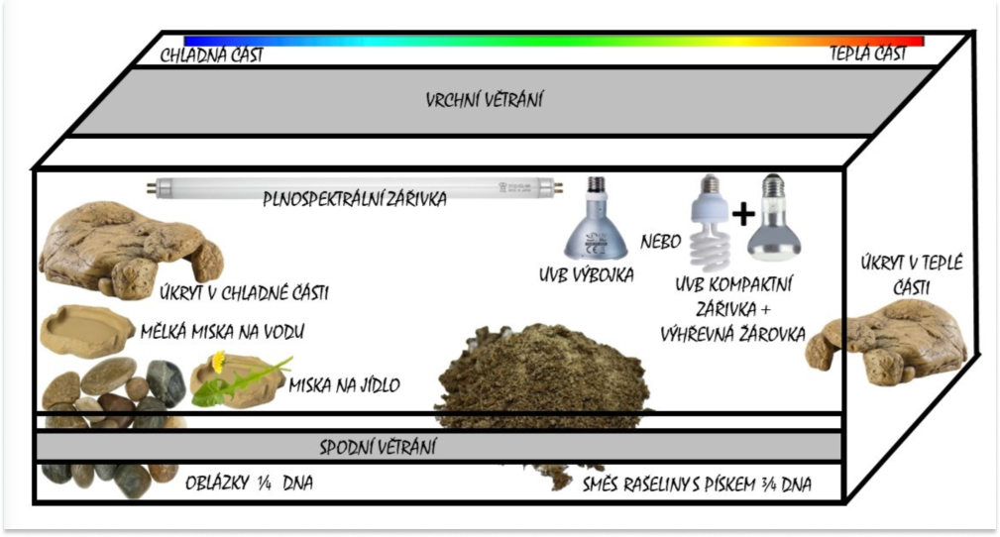

## Terárium a jak vybrat to správné

**VELIKOST:** volíme dle velikosti chovance. Čím větší, tím lepší (bude se i lépe dosahovat teplotního gradientu). Úplně minimální rozměr pro mládě je D60 x H40 x V45 cm.

**SUBSTRÁT:** na straně s výhřevem směs rašeliny s pískem (3:1), zde udržujeme jeden kout neustále vlhký. Na druhou stranu lze použít neostré oblázky, velikostně takové, aby je želva nemohla spolknout.

**MISKY:** na oblázky umístíme mělkou misku na vodu (neglazovanou – neklouzavou, aby se želvičce dobře lezlo dovnitř i ven), a misku na potravu, aby se zbytečně neobalovala substrátem.

## Osvětlení

V teráriu musí být umístěny 3 zdroje osvětlení:

1.  Zdroj tepla, aby se želvička mohla vyhřát.
2.  Zdroj UVB záření, které želvám vynahrazuje slunce a díky němuž jsou si schopny vytvářet vit. D3, jenž pak napomáhá správnému metabolismu vápníku. Měl by být umístěn vedle tepelného zdroje. UVB zdroje mají omezenou životnost, většinou maximálně rok.
3.  Plnospektrální dosvit terária – ideálně zářivková trubice přes celou délku terária, například Osram biolux, která má správnou barvu imitující denní světlo.

Možností jak zařídit první dva zdroje osvětlení je více (viz obr.) – Kompaktní zářivka + výhřevná žárovka či jen výbojka, která produkuje jak UVB tak i teplo. **Doba osvitu všech 3 zdrojů 12h/den.**

## Potrava

Potrava želv by měla být pokud možno co nejpestřejší, bohatá na vitamíny a minerální látky.

**V LÉTĚ:** pampeliška včetně květů, jitrocel, jetel, hluchavka, listy malin, jahodníku, locina, mochna, řebříček, granule, seno, občas můžete přilepšit jahodou, třešní či jablkem.

**V ZIMĚ:** čínské zelí, čekanka, polníček, rukola, římský salát, granule, seno.

Pokud svou želvičku krmíte pestře, není zpravidla potřeba dodávat navíc nějaké vitamíny a minerály, kromě vápníku (Uhličitan vápenatý). Tím je dobré sypat potravu cca **2-3x** do týdne po celý rok.

## Teploty

***TESTUDO HERMANNI*** – nejchladnější část: 22-25°C, výhřev: 35 – 40 – 45°C

***TESTUDO MARGINATA*** – nejchladnější část: 22-25°C, výhřev: 35 – 40°C

***TESTUDO GRAECA*** – nejchladnější část: 22-25°C, výhřev: 35 – 40°C

***TESTUDO HORSFIELDII*** – nejchladnější část: 20-25°C, výhřev: 35 – 40 – 45°C
