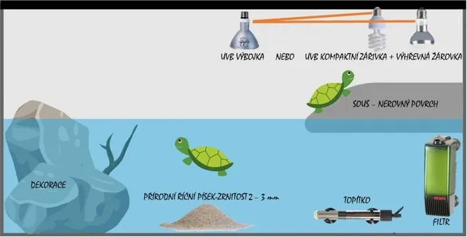

## Želvárium a jak vybrat to správné

**Velikost**: Velikost akvária volíme podle velikosti želvy, přičemž lze vycházet z následujícího pravidla pro minimální rozměry želvária:

-   **šířka**: 3× délka želvy,
-   **délka**: 5× délka želvy,
-   **výška vodního sloupce**: 2× délka želvy.

Je však třeba počítat s tím, že želva roste, a akvárium bude třeba časem vyměnit. V průměru se želvária mění za větší přibližně třikrát během života želvy.

**Topítko**: Umísťujeme ho vodorovně, vždy celé pod vodu, poblíž filtru, aby filtr rozptyloval ohřátou vodu do celého akvária.

**Filtrace**: Na začátku postačí vnitřní filtr s kapacitou na dvojnásobek objemu želvária. U dospělých želv však doporučujeme přechod na externí filtr pro efektivnější filtraci vody.

**Souš**: Souš by měla mít nerovný povrch, aby měla želva možnost uschnout i na spodní části krunýře, čímž se zabrání vzniku plísní.

## Osvětlení

Nad souší musí být umístěn zdroj tepla, který umožní želvě se vyhřát a uschnout, a především zdroj UVB záření. UVB záření želvám nahrazuje sluneční světlo a umožňuje jim vytvářet vitamín D3, který je klíčový pro správný metabolismus vápníku. Existuje několik možností, jak toto zajistit (viz obrázek) – například kombinace kompaktní zářivky a výhřevné žárovky, nebo jen jedna výbojka, která produkuje jak UVB záření, tak teplo. Oba zdroje by měly být zapnuté po dobu **12 hodin denně**.

**UVB zdroje mají omezenou životnost, obvykle maximálně jeden rok.**

## Potrava

Potrava želv by měla být pokud možno co nejpestřejší, bohatá na vitamíny a minerální látky. Potravu požírají želvy **jen ve vodě**, mláďata každý den, **dospělci** cca **3krát týdně**. Mláďata jsou téměř výhradně **masožravá**, jak želvy rostou postupně vzrůstá i podíl **rostlinné složky** v jejich potravě.

***ŽIVOČIŠNÁ SLOŽKA***  
Pro želvy je vhodné krmit je sladkovodními rybami a libovým masem – nikdy ne tučným. Doporučuje se kuřecí srdíčka, žaludky, játra, králičí maso, myší holátka, hmyz, plži, granule, vařené vejce na tvrdo (i se skořápkou), žížaly, krevetky a gamarus, ale ty by měly být podávány jen v omezeném množství.

***ROSTLINNÁ SLOŽKA***  
Mezi vhodné rostliny patří pampelišky, jitrocel, jetel, jablko, hruška, jahoda, okurka, čínské zelí, špenát, mrkev a akvarijní rostliny jako Egeria, Echinodorus či Cabomba.

Pokud krmíte svou želvu pestrou stravou, obvykle není potřeba dodávat další vitamíny a minerály, kromě vápníku. Ten je zvláště důležitý pro mláďata, a proto by v želváriu neměla chybět sepiová kost nebo „želvík“ (vápníkový blok).

## Teplota

**PSEUDEMYS SP.** voda: mláďata- 25-27°C, dospělci- 24°C, výhřev: 30-35°C

**GRAPTEMYS SP.** voda: mláďata 26-28°C, dospělci- 24-25°C, výhřev: 32-37°C

**TRACHEMYS SP.** voda: mláďata- 26-28°C, dospělci- 24-26°C, výhřev: 32-35°C

**CHRYSEMYS PICTA** voda: mláďata 25-27°C, dospělci- 24-25°C, výhřev: 31-34°C

**STENOTHERUS ODORATUS** voda: mláďata 25-27°C, dospělci- 24-26°C, výhřev: 30-33°C
