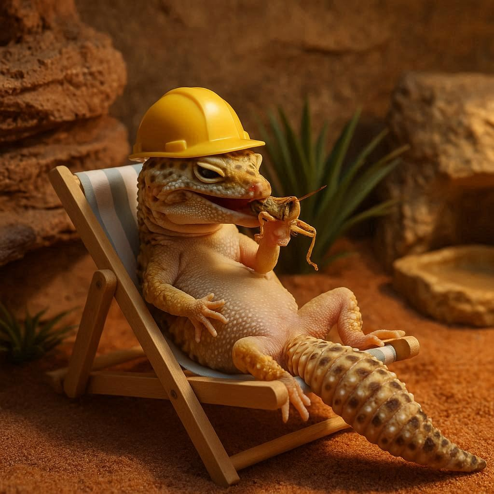

> *Gekončík noční patří k nejoblíbenějším terarijním zvířatům.  
> Díky své nenáročnosti, zajímavému vzhledu a klidné povaze je vhodný i pro začátečníky. Aby se mu u vás dařilo, je potřeba zajistit správné prostředí, vyváženou stravu a trochu pozornosti.*

## Terárium
**Velikost:**

-   Minimální rozměr pro jednoho gekončíka: **50 × 40 × 45 cm**
    
-   Každý další jedinec: přidejte **minimálně 10 cm na délku**
    
-   Čím větší terárium, tím lépe – umožníte vytvoření teplotních rozdílů.
    

**Substrát:**

-   Říční písek
    
-   Směs rašeliny s pískem (1:2)
    
-   Bentonitový kočkolit
    

**Výhřev:**

-   Výhřevné žárovky, topné kameny nebo podložky
    
-   Podle velikosti terária lze zdroje kombinovat
    

## Osvětlení a teplota
-   **Noční tvor:** UVB světlo není nezbytné
    
-   **Zdroj tepla je klíčový**
    

**Teplota ve dne:**

-   Výhřevné místo: až **35 °C**
    
-   Chladnější část: cca **25 °C**
    

**Teplota v noci:**

-   Ideální je pokles na **22 °C**
    

**Zimování (pro odchov):**

-   Snížení teploty na **20–22 °C** po dobu 1–3 měsíců
    

**Dosvícení:**

-   LED pásky nebo plnospektrální zářivka, **12 hodin denně**
    

## Krmení a doplňky
**Strava:** pestrá, bohatá na vitamíny a minerály

**Čím krmit:**

-   Cvrčky, šváby, sarančata
    
-   Mouční červi, červi Zophobas
    
-   V létě i smýkaný hmyz z louky
    
-   Samicím v období snůšky výjimečně myší holátko
    

**Frekvence:**

-   **Mláďata:** denně
    
-   **Dospělí:** cca 3× týdně
    

**Doplňky výživy:**

-   Miska s vápníkem vždy k dispozici
    
-   Krmení posypané vápníkem a **jednou týdně vitaminovým přípravkem** (např. Nekton MSA, Roboran, Reptivite)
    
-   Zdroje vápníku: mletý vápenec, aquamin, drcené skořápky nebo sépiová kost
    

## Společné soužití
-   Samci i samice se dají chovat samostatně
    
-   Skupiny: **jen samice** nebo **1 samec + 2–5 samic**
    
-   Nikdy dva samce pohromadě – hrozí souboje
    

## Rozmnožování a odchov mláďat
-   Po zimování dochází k páření
    
-   Samice kladou snůšky **2–4 týdny po páření**
    
-   Ve snůšce obvykle **2 vejce**
    
-   Vajíčka ukládají do kladiště: uzavřená nádoba s vlhkým substrátem (rašelina + písek 1:1)
    

**Inkubace:**

-   Vlhost: 70–80 %
    
-   Teplota: 26–31 °C
    

**Určení pohlaví dle teploty:**

-   26–28 °C → **samičky** (líhnutí 55–70 dní)
    
-   30–31 °C → **samci** (líhnutí cca 45 dní)
    

## Závěr
Gekončíci noční jsou vděčnými společníky, kteří při správné péči mohou dělat radost mnoho let. Nejsou nároční, ale vyžadují **pečlivě udržované prostředí, kvalitní výživu a trochu trpělivosti**.

> *Pokud si nejste jisti s nastavením podmínek nebo řešíte zdravotní obtíže svého gekončíka, **neváhejte kontaktovat naši veterinární kliniku** – rádi vám poradíme.*
